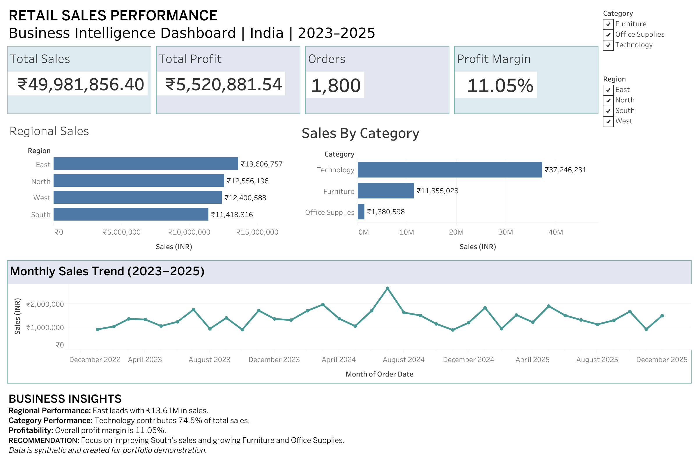

# Retail Sales Performance Analysis

An interactive Business Intelligence dashboard built using Tableau Public to analyze retail sales performance across regions, product categories, and time.

## Project Overview

This project analyzes a retail dataset covering 2023–2025. The dashboard provides insights into sales, profit, order volume, regional performance, and product category contributions.

**Note:** The dataset is synthetic and was created for portfolio demonstration purposes.

## Dashboard Preview

[View Interactive Dashboard on Tableau Public](https://public.tableau.com/app/profile/anirudh.chauhan2692/viz/Retail_Sales_Performance_Analysis_17947315661120/Dashboard1?publish=yes)

## Key Performance Indicators

| KPI | Result |
|---|---:|
| Total Sales | ₹49,981,856 |
| Total Profit | ₹5,520,882 |
| Total Orders | 1,800 |
| Profit Margin | 11.05% |

## Key Insights

- **Regional Performance:** East recorded the highest sales at approximately ₹13.61 million.
- **Category Performance:** Technology contributed approximately 74.5% of total sales.
- **Regional Opportunity:** South recorded the lowest sales at approximately ₹11.42 million.
- **Profitability:** Overall profit margin was 11.05%.

## Dashboard Features

- KPI cards for key business metrics.
- Regional sales comparison.
- Sales by product category.
- Monthly sales trend analysis.
- Interactive Region and Category filters.
- Business insights and recommendations.

## Tools Used

- Tableau Public – Dashboard development and visualization.
- Microsoft Excel / CSV – Dataset handling.
- Data Analysis – KPI calculation and business interpretation.

## Recommendations

- Investigate opportunities to improve sales in the South region.
- Explore ways to grow Furniture and Office Supplies sales.
- Monitor profit margins while increasing overall revenue.

## Dataset Information

- Time period: January 2023 – December 2025.
- Records: 1,800.
- Data type: Synthetic retail sales data.
- Currency: Indian Rupees (INR).

## Author

Anirudh Singh Chauhan

B.Tech Computer Science Engineering | Aspiring Data Analyst

[GitHub](https://github.com/HexBurst) | [LinkedIn](https://www.linkedin.com/in/anirudh-singh-chauhan-874461321/)

## Dashboard Preview

